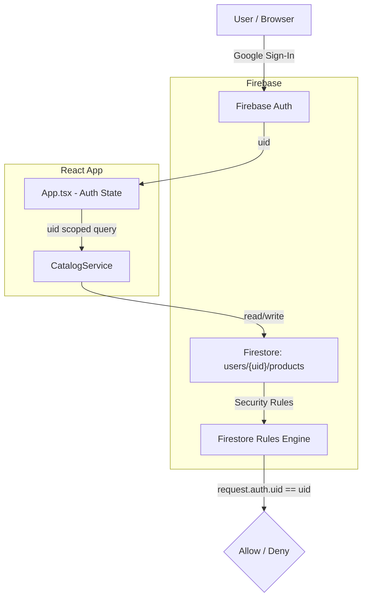
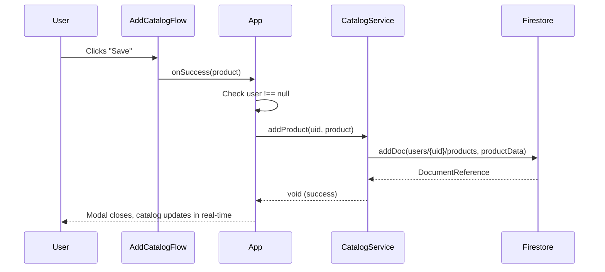
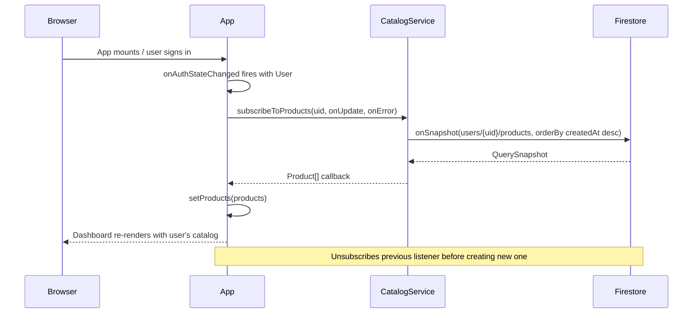
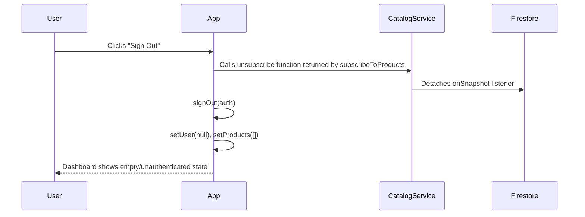

# Design Document: Firestore Catalog Persistence

## Overview

This feature adds user-scoped persistence for cataloged products in KatalogitAI. Each product saved through `AddCatalogFlow` is written to a Firestore sub-collection (`users/{uid}/products/{productId}`) that is owned by the authenticated user, ensuring data isolation between accounts. Firestore Security Rules enforce that only the owning user can read or write their own catalog items, with no cross-user data leakage.

The app already has Firebase initialized (`src/lib/firebase.ts`), Google Sign-In working, and a flat `products` collection with open read rules. This feature migrates catalog storage to a per-user sub-collection model, updates the Firestore Security Rules accordingly, and threads the authenticated `uid` through the data layer so the UI continues to work without behavioral changes from the user's perspective.

## Architecture



The `App` component owns both auth state and catalog state. A new `CatalogService` module (`src/lib/catalogService.ts`) abstracts all Firestore reads and writes, accepting the authenticated `uid` as a parameter to scope every operation.

## Sequence Diagrams

### Save a New Cataloged Product



### Load User's Catalog on Auth State Change



### User Signs Out



## Components and Interfaces

### CatalogService (`src/lib/catalogService.ts`)

**Purpose**: Encapsulate all Firestore operations for the `users/{uid}/products` sub-collection. Acts as the single data access layer for catalog persistence.

**Interface**:
```typescript
/**
 * Returns an unsubscribe function. Calls onUpdate with the latest
 * product list whenever Firestore emits a snapshot.
 */
export function subscribeToProducts(
  uid: string,
  onUpdate: (products: Product[]) => void,
  onError: (error: Error) => void
): Unsubscribe

/**
 * Writes a new product document to users/{uid}/products.
 * Strips the local `id` field; Firestore assigns the document ID.
 */
export function addProduct(uid: string, product: Product): Promise<void>

/**
 * Hard-deletes a product document from users/{uid}/products.
 */
export function deleteProduct(uid: string, productId: string): Promise<void>

/**
 * Performs a partial update (patch) on a product document.
 * Used for status changes (approve / reject).
 */
export function updateProduct(
  uid: string,
  productId: string,
  patch: Partial<Product>
): Promise<void>
```

**Responsibilities**:
- Build the correct Firestore path (`users/{uid}/products`) for every operation
- Apply `orderBy('createdAt', 'desc')` on real-time queries
- Map Firestore `DocumentSnapshot` → `Product` (merge `doc.id` with `doc.data()`)
- Propagate errors to the caller via thrown errors or the `onError` callback

### App Component (`src/App.tsx`) — modified

**Responsibilities**:
- Subscribe/unsubscribe `CatalogService.subscribeToProducts` in a `useEffect` that reruns whenever `user` changes
- Pass `user.uid` to every `CatalogService` call
- Clear `products` and cancel the active subscription when the user signs out

### Firestore Security Rules (`firestore.rules`) — updated

**Responsibilities**:
- Lock down `users/{uid}/products/{productId}` so only the owning `uid` can read or write
- Remove the old open `allow list/get: if true` rule from the flat `products` collection (if retained, it must be explicitly denied or the collection migrated)

## Data Models

### StoredProduct (Firestore document shape)

```typescript
// Written to: users/{uid}/products/{auto-id}
interface StoredProduct {
  // Ownership — written on create, never updated
  uid: string               // Firebase Auth uid of the owner

  // Core product fields (mirror of existing Product interface)
  sku: string
  title: string
  category: string
  subcategory: string
  description: string
  price: number
  status: 'active' | 'draft' | 'review'
  imageUrl: string          // base64 JPEG, max 1 MB
  aiImageProduct?: string   // base64 PNG, max 1 MB, optional
  aiImageLifestyle?: string // base64 PNG, max 1 MB, optional
  tags: string[]
  attributes: {
    Color: string
    Material: string
    Pattern: string
    Fit: string
    Occasion: string
    Gender: string
    Size_type: string
  }
  embedding?: number[]      // Gemini embedding vector, optional
  createdAt: number         // Unix timestamp ms, set on create, immutable
}
```

**Validation Rules**:
- `uid` must equal `request.auth.uid` at create time (enforced in Security Rules)
- `imageUrl` size ≤ 1,048,576 bytes (1 MB base64 string length)
- `status` must be one of `['active', 'draft', 'review']`
- `createdAt` is immutable — update operations must not change it
- `sku`, `title`, `category`, `subcategory`, `description` must be non-empty strings
- `price` must be a positive number

### In-memory `Product` type (`src/types.ts`)

The existing `Product` interface gains one field:

```typescript
export interface Product {
  id: string        // Firestore document ID (client-side only)
  uid?: string      // Owner's Firebase uid — present on stored products
  // ... all existing fields unchanged
}
```

## Algorithmic Pseudocode

### subscribeToProducts

```pascal
PROCEDURE subscribeToProducts(uid, onUpdate, onError)
  INPUT: uid (string), onUpdate (callback), onError (callback)
  OUTPUT: unsubscribe (function)

  PRECONDITION: uid is non-empty string
  
  SEQUENCE
    colRef ← collection(db, 'users', uid, 'products')
    q ← query(colRef, orderBy('createdAt', 'desc'))
    
    unsubscribe ← onSnapshot(q,
      snapshot =>
        SEQUENCE
          products ← []
          FOR each docSnap IN snapshot.docs DO
            product ← { id: docSnap.id, ...docSnap.data() }
            products.push(product)
          END FOR
          onUpdate(products)
        END SEQUENCE,
      error =>
        onError(error)
    )
    
    RETURN unsubscribe
  END SEQUENCE
  
  POSTCONDITION: Returns a function that, when called, stops the listener
END PROCEDURE
```

**Preconditions:**
- `uid` is a non-empty string matching an authenticated Firebase user
- `db` is a valid, initialized Firestore instance

**Postconditions:**
- Calls `onUpdate` immediately with existing products, then again on every change
- Returns an `Unsubscribe` function — caller must invoke it to prevent memory leaks
- Any Firestore error is routed to `onError` rather than thrown

### addProduct

```pascal
PROCEDURE addProduct(uid, product)
  INPUT: uid (string), product (Product)
  OUTPUT: void (Promise)

  PRECONDITION: uid is non-empty; product has all required fields

  SEQUENCE
    { id, ...data } ← product           // strip client-only id
    data.uid ← uid                       // stamp ownership
    
    colRef ← collection(db, 'users', uid, 'products')
    await addDoc(colRef, data)
  END SEQUENCE

  POSTCONDITION: Document exists at users/{uid}/products/{newId}
  POSTCONDITION: data.uid === uid
END PROCEDURE
```

### Auth-Scoped Subscription Lifecycle in App

```pascal
PROCEDURE manageSubscription(user)
  INPUT: user (User | null)
  OUTPUT: cleanup function

  SEQUENCE
    IF user IS NOT null THEN
      unsubscribe ← CatalogService.subscribeToProducts(
        user.uid,
        products => setProducts(products),
        error   => handleError(error)
      )
      RETURN unsubscribe   // React useEffect cleanup
    ELSE
      setProducts([])
      RETURN no-op
    END IF
  END SEQUENCE
END PROCEDURE

// Called in:
useEffect(() => {
  cleanup ← manageSubscription(user)
  RETURN cleanup
}, [user])
```

**Loop Invariants (snapshot listener):**
- Every document in the snapshot has a non-empty `id` matching its Firestore document ID
- The `uid` field on each product equals the authenticated user's `uid`

## Key Functions with Formal Specifications

### `subscribeToProducts(uid, onUpdate, onError): Unsubscribe`

**Preconditions:**
- `uid.length > 0`
- `onUpdate` is a callable function
- `onError` is a callable function
- Firebase `db` instance is initialized

**Postconditions:**
- Returns a non-null `Unsubscribe` function
- `onUpdate` is called at least once synchronously (after the first snapshot) with a `Product[]`
- If `uid` changes (user signs out and in), the previous listener is unsubscribed before creating a new one
- Calling the returned `Unsubscribe` stops further `onUpdate` invocations

**Loop Invariants:** For each document in the snapshot, `doc.data().uid === uid`

---

### `addProduct(uid, product): Promise<void>`

**Preconditions:**
- `uid === auth.currentUser.uid` (enforced by Security Rules)
- `product.title.length > 0 && product.sku.length > 0`
- `product.price > 0`
- `product.imageUrl.length <= 1_048_576`
- `product.status ∈ { 'active', 'draft', 'review' }`

**Postconditions:**
- A document exists at `users/{uid}/products/{newId}`
- `document.uid === uid`
- `document.createdAt === product.createdAt` (immutable after write)
- Throws if the Security Rule rejects the write

---

### `deleteProduct(uid, productId): Promise<void>`

**Preconditions:**
- `uid === auth.currentUser.uid`
- `productId` is a valid non-empty Firestore document ID

**Postconditions:**
- No document exists at `users/{uid}/products/{productId}`
- Throws if the document did not exist or if the rule denies the delete

---

### `updateProduct(uid, productId, patch): Promise<void>`

**Preconditions:**
- `uid === auth.currentUser.uid`
- `patch` does not include `createdAt` or `uid` (immutable fields)
- If `patch.status` is present, `patch.status ∈ { 'active', 'draft', 'review' }`

**Postconditions:**
- All keys in `patch` are updated on the document
- `document.createdAt` is unchanged
- `document.uid` is unchanged

## Firestore Security Rules Design

```
rules_version = '2';
service cloud.firestore {
  match /databases/{database}/documents {

    // Default deny all
    match /{document=**} {
      allow read, write: if false;
    }

    // User-scoped catalog — only the owner can access their products
    match /users/{uid}/products/{productId} {

      // Only the authenticated owner can list/read their products
      allow list, get: if request.auth != null
                       && request.auth.uid == uid;

      // Create: must be signed in as the owner; document must be valid
      allow create: if request.auth != null
                    && request.auth.uid == uid
                    && isValidProduct(request.resource.data)
                    && request.resource.data.uid == uid;

      // Update: signed-in owner; still valid; createdAt + uid unchanged
      allow update: if request.auth != null
                    && request.auth.uid == uid
                    && (
                         // Full update
                         (isValidProduct(request.resource.data)
                          && request.resource.data.createdAt == resource.data.createdAt
                          && request.resource.data.uid == resource.data.uid)
                         ||
                         // Status-only patch
                         (request.resource.data.diff(resource.data)
                            .affectedKeys().hasOnly(['status'])
                          && request.resource.data.status in ['active','draft','review'])
                       );

      // Delete: signed-in owner only
      allow delete: if request.auth != null
                    && request.auth.uid == uid;
    }
  }

  function isValidProduct(data) {
    return data.keys().hasAll([
             'uid','sku','title','category','subcategory',
             'description','price','status','imageUrl','tags',
             'attributes','createdAt'
           ])
        && data.uid is string
        && data.sku is string && data.sku.size() > 0 && data.sku.size() <= 100
        && data.title is string && data.title.size() > 0 && data.title.size() <= 500
        && data.category is string
        && data.price is number && data.price > 0
        && data.status in ['active', 'draft', 'review']
        && data.imageUrl is string && data.imageUrl.size() <= 1048576
        && data.createdAt is number
        && (data.get('aiImageProduct', null) == null
            || (data.aiImageProduct is string && data.aiImageProduct.size() <= 1048576))
        && (data.get('aiImageLifestyle', null) == null
            || (data.aiImageLifestyle is string && data.aiImageLifestyle.size() <= 1048576));
  }
}
```

## Error Handling

### Scenario 1: Unauthenticated Write Attempt

**Condition**: `addProduct` / `deleteProduct` / `updateProduct` called without a signed-in user, or the Security Rule rejects the write.

**Response**: The calling function in `App.tsx` checks `user !== null` before calling `CatalogService`. If the Firestore rule still rejects (e.g. stale token), `handleFirestoreError` is called, which logs the full `FirestoreErrorInfo` object and re-throws.

**Recovery**: The UI should catch the thrown error, display a toast notification, and leave product state unchanged.

---

### Scenario 2: Subscription Fails (permission-denied)

**Condition**: `onSnapshot` emits an error with code `permission-denied` — typically because the user just signed out and the listener wasn't unsubscribed fast enough.

**Response**: The `onError` callback receives the error. `App.tsx` must handle `permission-denied` silently (don't show an alert) and simply clear `products`.

**Recovery**: The `useEffect` cleanup will unsubscribe the listener when `user` becomes `null`.

---

### Scenario 3: Document Too Large

**Condition**: A product document with base64 images exceeds Firestore's 1 MB document limit.

**Response**: `addDoc` rejects with a `resource-exhausted` or similar error. `handleAddProduct` in `App.tsx` catches it and displays a user-facing message: *"The product images are too large. Try capturing a simpler image."*

**Recovery**: The `AddCatalogFlow` modal remains open so the user can retry.

---

### Scenario 4: Network Offline

**Condition**: The device is offline when a write is attempted.

**Response**: Firestore's offline persistence caches the write locally. The operation's Promise resolves immediately (offline writes are enqueued). When connectivity is restored, Firestore syncs automatically.

**Recovery**: No explicit recovery needed — Firestore handles it transparently. The `experimentalForceLongPolling: true` setting already in `firebase.ts` accommodates restricted network environments.

## Testing Strategy

### Unit Testing Approach

Test `CatalogService` functions in isolation by mocking the Firestore SDK:

- `subscribeToProducts`: verify it constructs the correct path (`users/{uid}/products`), applies `orderBy('createdAt', 'desc')`, maps snapshots to `Product[]` correctly, and returns an unsubscribe function.
- `addProduct`: verify it strips the `id` field, stamps `uid`, and calls `addDoc` with the correct collection reference.
- `deleteProduct`: verify it calls `deleteDoc` with `users/{uid}/products/{productId}`.
- `updateProduct`: verify it calls `updateDoc` with the correct path and patch, and rejects if `patch` contains `createdAt`.

### Property-Based Testing Approach

**Property Test Library**: `fast-check`

Properties to verify:
- For any valid `Product` p and `uid` u, `addProduct(u, p)` produces a Firestore document where `document.uid === u` and `document.id !== p.id` (Firestore assigned a new ID).
- For any `patch` that does not include `createdAt`, `updateProduct` does not modify `createdAt` on the resulting document.
- For any `uid` that differs from `request.auth.uid`, the Security Rule denies read and write (tested via Firebase Emulator rules testing).

### Integration Testing Approach

Use the **Firebase Local Emulator Suite** (`firebase emulators:start`) to run rules tests:

- Authenticated user can CRUD their own `users/{uid}/products` documents.
- Authenticated user cannot read or write `users/{otherUid}/products` documents.
- Unauthenticated requests are denied on all operations.
- `isValidProduct` rejects documents missing required fields or with oversized `imageUrl`.

## Performance Considerations

- Queries are scoped to `users/{uid}/products` — no full-collection scans across all users' data.
- `orderBy('createdAt', 'desc')` requires a composite index on `(createdAt DESC)` within the sub-collection (Firestore auto-creates this for single-field queries; if a compound filter is added later, a manual index entry in `firestore.indexes.json` will be needed).
- The `limit(100)` cap on the existing query should be carried over to `subscribeToProducts` to bound memory usage.
- Large base64 images are compressed before writing (already handled in `AddCatalogFlow.handleSave`). The 1 MB per image field limit is enforced both in the Security Rules and in `AddCatalogFlow`.

## Security Considerations

- **Data isolation**: Every Firestore operation is path-scoped to `users/{uid}/products`. There is no query or rule that allows cross-user data access.
- **Ownership stamping**: The `uid` field is written on create and validated in the Security Rule (`request.resource.data.uid == uid`). It is immutable — the update rule requires `incoming().uid == existing().uid`.
- **No client-side trust**: Access control decisions live entirely in Firestore Security Rules, not in application code. Even if the React app is bypassed (e.g. direct SDK call from browser console), the rules enforce ownership.
- **Auth token expiry**: Firebase Auth tokens auto-refresh; the `onAuthStateChanged` listener in `App.tsx` will fire on token refresh. No special handling is needed.
- **Seed / demo data**: The existing `seedDemoData` function writes to the flat `products` collection. It should be updated to write to `users/{uid}/products` or removed in production.

## Dependencies

| Dependency | Version | Purpose |
|---|---|---|
| `firebase` (Firestore SDK) | already installed | `collection`, `query`, `orderBy`, `onSnapshot`, `addDoc`, `deleteDoc`, `updateDoc`, `doc` |
| `firebase/auth` | already installed | `User.uid` for path scoping |
| Firebase Local Emulator Suite | (dev only) | Integration / rules testing |
| `fast-check` | ^3.x | Property-based unit tests |

## Correctness Properties

*A property is a characteristic or behavior that should hold true across all valid executions of a system — essentially, a formal statement about what the system should do. Properties serve as the bridge between human-readable specifications and machine-verifiable correctness guarantees.*

### Property 1: Ownership Invariant

For any product document written to Firestore and any authenticated `uid`, the document's `uid` field must equal the authenticated user's `uid`. No write with a mismatched `uid` is permitted.

**Validates: Requirements 3.1**

```
∀ doc ∈ users/{uid}/products : doc.uid === uid
```

### Property 2: Isolation Invariant

For any two distinct authenticated users `u1 ≠ u2`, all read and write attempts by `u1` against `users/{u2}/products` must be denied by the SecurityRules.

**Validates: Requirements 3.2**

```
∀ u1, u2 where u1 ≠ u2 :
  READ(users/{u2}/products/*, auth.uid = u1) → DENIED
  WRITE(users/{u2}/products/*, auth.uid = u1) → DENIED
```

### Property 3: Immutable Fields on Update

For any update operation on a product document, both the `createdAt` and `uid` fields must remain unchanged. The SecurityRules must deny any update that modifies either of these fields, and CatalogService must not include them in any patch sent to Firestore.

**Validates: Requirements 2.3, 3.3, 3.4**

```
∀ update(uid, productId, patch) :
  document_after.createdAt === document_before.createdAt
  document_after.uid === document_before.uid
```

### Property 4: Snapshot-to-Product Mapping

For any Firestore snapshot containing N document snapshots, the `onUpdate` callback must receive a `Product[]` of length N where every item's `id` equals its corresponding Firestore document ID and all document data fields are present.

**Validates: Requirements 1.2**

```
∀ snapshot with docs[0..N-1] :
  |onUpdate result| === N
  ∀ i : result[i].id === docs[i].id
  ∀ i : result[i] contains all fields from docs[i].data()
```

### Property 5: addProduct Strips id and Stamps uid

For any valid `Product` object and any `uid` string, `addProduct(uid, product)` must call `addDoc` with data that omits the client-side `id` field and sets `uid` to the provided `uid`.

**Validates: Requirements 2.1**

```
∀ uid, product :
  addDoc called with data where
    'id' ∉ data.keys
    data.uid === uid
```

### Property 6: Subscription Cleanup

For any `uid`, calling the `Unsubscribe` function returned by `subscribeToProducts` must prevent any further invocations of `onUpdate` regardless of how many subsequent Firestore changes occur.

**Validates: Requirements 4.2, 4.3**

```
unsubscribe = subscribeToProducts(uid, onUpdate, onError)
unsubscribe()
∀ subsequent Firestore changes : onUpdate is NOT called
```

### Property 7: No Ghost Reads After Sign-Out

For any initial product list state, after the user signs out the App's `products` state must be empty until a new user signs in.

**Validates: Requirements 4.1**

```
∀ initial products[] :
  signOut() → products === []
```

### Property 8: Valid Status Transitions

For any `patch` passed to `updateProduct` that contains a `status` field, the update must succeed if and only if `patch.status ∈ { 'active', 'draft', 'review' }`. Any other value must be rejected by both CatalogService and the SecurityRules.

**Validates: Requirements 2.4, 5.2, 5.6**

```
∀ patch where 'status' ∈ patch.keys :
  patch.status ∈ { 'active', 'draft', 'review' } → update succeeds
  patch.status ∉ { 'active', 'draft', 'review' } → update rejected
```

### Property 9: Document Validation Rejects Incomplete or Oversized Documents

For any document attempted to be written to `users/{uid}/products`, the SecurityRules must deny the write if any required field is missing, if `price` is not a positive number, or if `imageUrl` or any provided optional AI image field exceeds 1,048,576 bytes.

**Validates: Requirements 5.1, 5.3, 5.4, 5.5**

```
∀ document d :
  (d is missing any required field) → DENIED
  (d.price ≤ 0) → DENIED
  (d.imageUrl.size > 1048576) → DENIED
  (d.aiImageProduct provided && d.aiImageProduct.size > 1048576) → DENIED
  (d.aiImageLifestyle provided && d.aiImageLifestyle.size > 1048576) → DENIED
```
